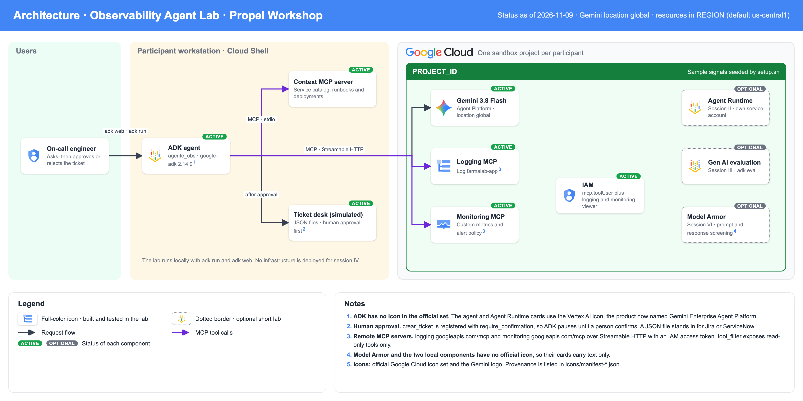

# Workshop Propel · Farmatodo · Agentes en Google Cloud

Labs del workshop de agentes con Agent Development Kit (ADK). El núcleo es el hands-on de la sesión IV: un **agente de observabilidad** que lee señales de Cloud Logging y Cloud Monitoring por MCP, toma contexto de sistemas externos y abre un ticket con aprobación humana previa. El resto son ejemplos cortos para seguir las demos.

El repo es autocontenido: trae el setup, las señales de ejemplo, las guías, las soluciones por paso, la limpieza y la solución de problemas. Todo el escenario es **ficticio** (una cadena inventada llamada Farmalab) y no usa datos reales.



## Empezar en 3 comandos

En **Cloud Shell**, con un proyecto sandbox propio (ver [`PRERREQUISITOS.md`](PRERREQUISITOS.md)):

```bash
export PROJECT_ID=tu-proyecto          # Cloud Shell no la trae definida
git clone https://github.com/jarcenaxmos/propel-workshop-farmatodo.git && cd propel-workshop-farmatodo
./setup.sh
```

`setup.sh` muestra el proyecto y pide confirmación antes de crear nada. Tarda de 3 a 5 minutos y termina con una verificación que debe decir `Todo listo.` Después:

```bash
source .venv/bin/activate
```

## Labs

| Sesión | Lab | Tiempo | Guía |
|---|---|---|---|
| **IV · ADK y Model Context Protocol** | **Hands-on: agente de observabilidad con MCP y aprobación humana** | **90 min** (65 de camino principal; los pasos 4 y 6 son opcionales) | [`sesion-4-adk-mcp/guia.md`](sesion-4-adk-mcp/guia.md) |
| II · Agent Runtime y Agent Registry | Desplegar el agente con Agent Identity, verlo registrado y publicar una skill versionada | 18 min (8 de espera) | [`sesion-2-agent-runtime/guia.md`](sesion-2-agent-runtime/guia.md) |
| III · Gen AI Evaluation | Evaluar el agente con `adk eval`: trayectoria, rúbricas y una regresión | 13 min | [`sesion-3-evaluacion/guia.md`](sesion-3-evaluacion/guia.md) |
| V · Agentes en producción | Trazas del agente desplegado: tiempos y tokens | 5 min | [`sesion-5-produccion/guia.md`](sesion-5-produccion/guia.md) |
| VI · Model Armor | Un template de Model Armor delante y detrás del modelo | 10 min | [`sesion-6-model-armor/guia.md`](sesion-6-model-armor/guia.md) |

La sesión I es charla y no tiene lab. Los ejemplos de II, III, V y VI usan la solución final de la sesión IV, así que se pueden hacer en cualquier orden después de `./setup.sh`. El de la sesión V necesita el despliegue de la sesión II.

## Qué crea `setup.sh` en tu proyecto

| Recurso | Detalle |
|---|---|
| APIs | `aiplatform`, `logging`, `monitoring` y, para los ejemplos cortos, `cloudresourcemanager`, `cloudtrace`, `telemetry`, `storage`, `modelarmor`, `agentregistry` |
| Log `farmalab-app` | Unas 300 entradas de la última hora, con un incidente en `pagos-gateway` |
| Métricas custom | `custom.googleapis.com/farmalab/error_rate` y `latency_p95_ms`, por servicio |
| Política de alertas | "Farmalab: tasa de error alta en pagos-gateway" |
| Local | `.venv/` con las dependencias y `.env` con tu proyecto |

Los ejemplos cortos crean además un agente en Agent Runtime, una skill en Agent Registry (sesión II), roles IAM para la Agent Identity del agente y un template de Model Armor. `cleanup.sh` borra todo, incluidos esos roles.

Las señales cubren la última hora. Si retomas el lab más tarde, renueva el incidente:

```bash
python scripts/sembrar_senales.py --forzar
```

## Estructura

```text
setup.sh  cleanup.sh  requirements.txt
PRERREQUISITOS.md  TROUBLESHOOTING.md
datos/                  catalogo de servicios ficticio
scripts/                sembrar_senales.py · verificar.py · probar_agente.py
sesion-4-adk-mcp/       guia.md · agente_obs/ (tu trabajo; conexion_google.py ya viene hecho) · servidor_contexto/ · solucion/paso-1..6
sesion-2-agent-runtime/ guia.md · desplegar.sh · otorgar_roles.sh · consultar.py · ver_registro.py · skills/
sesion-3-evaluacion/    guia.md · evalsets y configuraciones
sesion-5-produccion/    guia.md · ver_trazas.py
sesion-6-model-armor/   guia.md · crear_template.sh · probar_template.py · agente_protegido/
docs/architecture/      fuente HTML del diagrama y PNG
```

## Versiones probadas

Probado el 9 de noviembre de 2026 con Python 3.12.

| Componente | Versión |
|---|---|
| `google-adk` | 2.14.0, con los extras `mcp`, `eval`, `gcp` y `otel-gcp` |
| `mcp` | 2.3.0 |
| `google-cloud-modelarmor` | 0.7.5 |
| `google-cloud-aiplatform` | 2.7.0 |
| Modelo | `gemini-3.8-flash` en la ubicación `global` |

Están fijadas en `requirements.txt`. ADK publica versiones cada dos semanas y cambia interfaces, así que no las subas sin volver a probar los labs.

Para usar otra región u otro modelo: `REGION=us-east1 MODEL=gemini-3.5-flash ./setup.sh`.

## Limpieza

```bash
./cleanup.sh            # borra del proyecto todo lo que crearon los labs
./cleanup.sh --local    # ademas borra .venv, .env, tickets y archivos generados
```

Pide que escribas el id del proyecto para confirmar. No deshabilita APIs ni borra el proyecto. Después de borrar, espera unos 10 minutos antes de volver a ejecutar `./setup.sh`: Cloud Monitoring tarda en liberar las métricas borradas.

## Si algo falla

[`TROUBLESHOOTING.md`](TROUBLESHOOTING.md) tiene los errores que aparecieron al probar los labs y su solución.

## Uso del material

Material preparado por Axmos Technologies para este workshop. Todos los derechos reservados: puedes clonarlo y ejecutarlo para seguir el workshop y replicarlo en tus proyectos, pero no se concede licencia para redistribuirlo.
