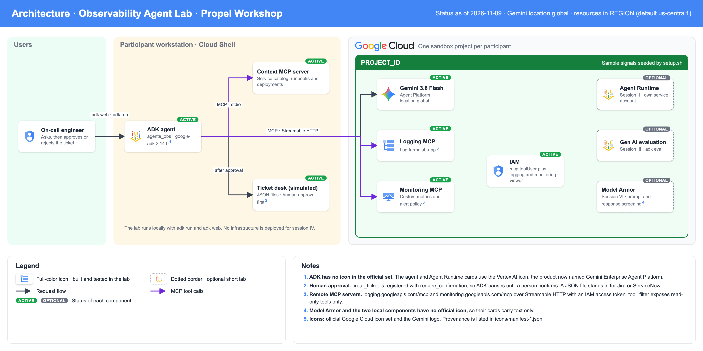

# Sesión IV · ADK y Model Context Protocol (hands-on, 90 min)

Vas a construir un **agente de observabilidad**: lee señales de Cloud Logging y Cloud Monitoring por MCP, toma contexto de un sistema externo (catálogo de servicios, runbooks y despliegues) y abre un ticket, pero solo después de que una persona lo aprueba.



El escenario es ficticio. **Farmalab** es una cadena de farmacias inventada, y `setup.sh` sembró en tu proyecto un incidente: el servicio `pagos-gateway` empezó a fallar hace unos minutos. Tu agente tiene que descubrir por qué.

| Paso | Qué haces | Tiempo |
|---|---|---|
| 0 | Preparar el entorno | 10 min |
| 1 | Un agente mínimo | 10 min |
| 2 | Leer Cloud Logging por MCP | 15 min |
| 3 | Sumar Cloud Monitoring por MCP | 15 min |
| 4 | Contexto de sistemas externos con un servidor MCP propio | 15 min |
| 5 | Abrir el ticket con aprobación humana | 15 min |
| 6 | Extra: un guardrail con un callback | 10 min |

**Cómo se trabaja.** Editas un solo archivo, `sesion-4-adk-mcp/agente_obs/agent.py`. Cada paso termina con un **punto de control**: un comando y lo que deberías ver. Si te atrasas, `./ponerse-al-dia.sh N` deja tu archivo como la solución del paso N y sigues desde ahí. Las soluciones completas están en `solucion/paso-N/`.

---

## Paso 0 · Preparar el entorno (10 min)

En **Cloud Shell**, con tu proyecto. La variable `PROJECT_ID` no viene definida en Cloud Shell, así que empieza por exportarla.

```bash
export PROJECT_ID=tu-proyecto          # el id de TU proyecto
git clone https://github.com/jarcenaxmos/propel-workshop-farmatodo.git
cd propel-workshop-farmatodo
./setup.sh
```

`setup.sh` tarda de 3 a 5 minutos. Habilita las APIs, crea un entorno virtual con ADK, escribe el archivo `.env` y siembra las señales de ejemplo. Termina con una verificación.

Después activa el entorno y entra a la carpeta del lab:

```bash
source .venv/bin/activate
cd sesion-4-adk-mcp
```

**Punto de control.** La verificación termina con `Todo listo.` y todas las líneas en `[ok]`. Puedes repetirla cuando quieras con `python ../scripts/verificar.py`.

> Si abres una terminal nueva, repite `cd propel-workshop-farmatodo && source .venv/bin/activate && cd sesion-4-adk-mcp`.

---

## Paso 1 · Un agente mínimo (10 min)

**Objetivo.** Tener un agente que responde, todavía sin herramientas.

Abre `agente_obs/agent.py` (en Cloud Shell: `cloudshell edit agente_obs/agent.py`). Ya trae la instrucción. Al final del archivo, reemplaza el comentario del PASO 1 por:

```python
root_agent = LlmAgent(
    name="agente_obs",
    model=MODEL,
    description="Ayuda a la guardia de Farmalab a entender incidentes.",
    instruction=instruccion,
)
```

Tres cosas para notar en el archivo:

- `root_agent` es lo único que ADK exige que exista.
- `instruction` es una **función**, no un texto fijo. ADK la llama en cada turno, y así el agente sabe la hora actual. Sin eso no podría armar un filtro de "la última hora".
- El modelo se fija en la ubicación `global`, porque Gemini 3.x no se sirve desde todas las regiones.

**Punto de control.**

```bash
adk run agente_obs "Quien eres y que hora es? Hay errores en pagos-gateway?"
```

El agente se presenta, dice la hora en UTC y aclara que **todavía no puede consultar** logs ni métricas. Si inventara errores, la instrucción está mal copiada.

---

## Paso 2 · Leer Cloud Logging por MCP (15 min)

**Objetivo.** Conectar el agente al servidor MCP remoto de Cloud Logging.

Google Cloud publica un servidor MCP por servicio. El de Logging está en `https://logging.googleapis.com/mcp` y se autentica con OAuth 2.0 e IAM, igual que la API. No hay nada que desplegar.

**2.1** Agrega estos imports arriba, junto a los demás:

```python
import google.auth
import google.auth.transport.requests
from google.adk.tools.mcp_tool import McpToolset
from google.adk.tools.mcp_tool import StreamableHTTPConnectionParams
```

**2.2** Debajo de la línea de `MODEL`, agrega la autenticación y el toolset:

```python
_credenciales, _ = google.auth.default(
    scopes=["https://www.googleapis.com/auth/cloud-platform"])


def encabezados_google(_contexto=None) -> dict[str, str]:
  """Encabezados de autenticacion. Renueva el token si ya vencio."""
  if not _credenciales.valid:
    _credenciales.refresh(google.auth.transport.requests.Request())
  return {
      "Authorization": f"Bearer {_credenciales.token}",
      "x-goog-user-project": PROJECT_ID,
  }


logging_mcp = McpToolset(
    connection_params=StreamableHTTPConnectionParams(
        url="https://logging.googleapis.com/mcp", timeout=30),
    header_provider=encabezados_google,
    tool_filter=["list_log_entries", "list_log_names"],
)
```

**2.3** En la instrucción, reemplaza el párrafo que empieza con "Todavia no tienes herramientas" por:

```text
SENALES DISPONIBLES

Logs de aplicacion (herramienta list_log_entries):
- filter: logName="projects/{PROJECT_ID}/logs/farmalab-app"
  AND timestamp>="{hace_una_hora.strftime(f)}" y agrega lo que necesites, por
  ejemplo AND severity>=ERROR o AND labels.service="pagos-gateway".
- Usa orderBy "timestamp desc" y pageSize 50.
- Campos: severity, labels.service, labels.version, jsonPayload.error_code,
  jsonPayload.message, jsonPayload.status, jsonPayload.tienda_id.
```

**2.4** Pásale el toolset al agente:

```python
root_agent = LlmAgent(
    ...
    instruction=instruccion,
    tools=[logging_mcp],
)
```

Qué acabas de usar:

- `header_provider` se llama en cada conexión, así el token nunca queda vencido. En tu máquina es tu usuario; desplegado, es la cuenta de servicio del agente.
- `tool_filter` decide qué herramientas ve el modelo. El servidor de Logging ofrece seis; el agente solo necesita leer entradas.

**Punto de control.**

```bash
python ../scripts/probar_agente.py agente_obs "Que errores hay en los logs de la ultima hora? Agrupa por servicio y error_code."
```

Ves una línea `[tool] list_log_entries` con un filtro que incluye `timestamp>=` y `severity>=ERROR`. La respuesta nombra `pagos-gateway` y el código `UPSTREAM_TIMEOUT`.

`probar_agente.py` ejecuta el agente una vez y muestra cada llamada a herramientas. Es el mismo agente que corre con `adk run` o `adk web`.

---

## Paso 3 · Sumar Cloud Monitoring por MCP (15 min)

**Objetivo.** Que el agente vea las métricas y las políticas de alerta.

**3.1** Debajo de `logging_mcp`, agrega:

```python
monitoring_mcp = McpToolset(
    connection_params=StreamableHTTPConnectionParams(
        url="https://monitoring.googleapis.com/mcp", timeout=30),
    header_provider=encabezados_google,
    tool_filter=["list_timeseries", "list_alert_policies"],
)
```

**3.2** En la instrucción, después del bloque de logs, agrega:

```text
Metricas (herramienta list_timeseries):
- custom.googleapis.com/farmalab/error_rate (fraccion de 0 a 1) y
  custom.googleapis.com/farmalab/latency_p95_ms, con la etiqueta service.
- Ejemplo de argumentos:
  filter: metric.type="custom.googleapis.com/farmalab/error_rate" AND
  metric.labels.service="pagos-gateway"
  interval: startTime "{hace_una_hora.strftime(f)}", endTime "{ahora.strftime(f)}"
  view: "FULL"
- Politicas de alerta: herramienta list_alert_policies.
```

**3.3** Agrega el toolset: `tools=[logging_mcp, monitoring_mcp],`

**Punto de control.**

```bash
python ../scripts/probar_agente.py agente_obs "Como viene la tasa de error y la latencia p95 de pagos-gateway en la ultima hora? Hay alguna politica de alerta sobre eso?"
```

Ves `[tool] list_timeseries` (una o dos veces) y `[tool] list_alert_policies`. La respuesta dice que la tasa de error pasó de menos de 1% a cerca de 18%, que la latencia p95 pasó de unos 400 ms a más de 4.000 ms, y nombra la política "Farmalab: tasa de error alta en pagos-gateway".

**Por qué `tool_filter` no es opcional aquí.** La definición de cada herramienta viaja al modelo en cada llamada. Medido en este lab con `gemini-3.8-flash`:

| Agente | Tokens de entrada por llamada |
|---|---|
| Paso 1, sin herramientas | 233 |
| Paso 2, Logging con 2 herramientas | 9.241 |
| Paso 3, más Monitoring con 2 herramientas | 45.705 |
| Monitoring sin `tool_filter` (9 herramientas) | la llamada falla: supera el máximo de 1.048.576 tokens |

Los esquemas de respuesta de Monitoring (dashboards, políticas) son enormes. Filtra siempre.

---

## Paso 4 · Contexto de sistemas externos con un servidor MCP propio (15 min)

**Objetivo.** Las señales dicen *qué* pasa. Para saber *por qué* y *a quién avisar*, el agente necesita datos que no están en Google Cloud: el catálogo de servicios, el runbook y los despliegues recientes.

Ese contexto lo entrega `servidor_contexto/server.py`, un servidor MCP de 70 líneas que ya está escrito. Ábrelo: cada función decorada con `@mcp.tool()` es una herramienta. Aquí lee un JSON; en tu empresa llamaría a tu CMDB o a tu pipeline de CI/CD.

La diferencia con los pasos 2 y 3 es el transporte. Los servidores de Google son remotos (Streamable HTTP). Este es local: ADK lo lanza como proceso hijo y le habla por **stdio**.

**4.1** Agrega los imports:

```python
import pathlib
import sys

from google.adk.tools.mcp_tool import StdioConnectionParams
from mcp import StdioServerParameters
```

**4.2** Debajo de `monitoring_mcp`, agrega:

```python
_LAB = pathlib.Path(__file__).resolve().parent
while not (_LAB / "servidor_contexto" / "server.py").exists():
  _LAB = _LAB.parent  # sube hasta la carpeta sesion-4-adk-mcp/
contexto_mcp = McpToolset(
    connection_params=StdioConnectionParams(
        server_params=StdioServerParameters(
            command=sys.executable,
            args=[str(_LAB / "servidor_contexto" / "server.py")]),
        timeout=30),
)
```

**4.3** En la instrucción, después del bloque de métricas, agrega:

```text
Contexto del negocio (catalogo de servicios, runbooks y despliegues):
herramientas listar_servicios, obtener_servicio y listar_despliegues.

COMO INVESTIGAR UN INCIDENTE
1. Metricas del servicio: desde cuando sube el error o la latencia.
2. Logs con severity>=ERROR: cual es el error_code dominante.
3. Ficha del servicio y despliegues recientes: compara la hora del despliegue
   con el inicio del problema y lee el runbook.
4. Resume: que pasa, desde cuando, impacto, causa probable y evidencia.
No repitas consultas que ya hiciste. Con 4 a 6 llamadas suele alcanzar.
```

**4.4** Agrega el toolset: `tools=[logging_mcp, monitoring_mcp, contexto_mcp],`

**Punto de control.**

```bash
python ../scripts/probar_agente.py agente_obs "Investiga que pasa con pagos-gateway: causa probable, equipo responsable y que dice el runbook."
```

Ves llamadas a `list_timeseries`, `list_log_entries`, `obtener_servicio` y `listar_despliegues`. La respuesta relaciona el incidente con el despliegue de la versión **3.8.2**, que bajó el timeout hacia el adquirente de 8 s a 2 s, e indica que el equipo responsable es **Pagos**.

---

## Paso 5 · Abrir el ticket con aprobación humana (15 min)

**Objetivo.** El agente ya sabe qué pasa. Ahora actúa: abre un ticket. Como es una acción hacia afuera, una persona la aprueba antes.

La función `crear_ticket` ya está en `agente_obs/tickets.py`. Simula una mesa de ayuda: cada ticket es un archivo JSON en la carpeta `tickets/`. Así el lab no depende de Jira ni de ServiceNow.

**5.1** Agrega los imports:

```python
from google.adk.tools import FunctionTool

from .tickets import crear_ticket
```

**5.2** En la instrucción, antes de la línea "Responde en espanol", agrega:

```text
TICKETS
- Propone el ticket solo cuando tengas evidencia de logs y de metricas.
- Llama a crear_ticket con el equipo y la accion que indica el runbook.
  Una persona debe aprobarlo antes de que se cree. Si lo rechaza, no insistas:
  pregunta que cambiar.
- Nunca ejecutes ni prometas acciones correctivas (rollback, reinicios).
  Solo las recomiendas en el ticket.
```

**5.3** Agrega la herramienta con confirmación:

```python
    tools=[
        logging_mcp,
        monitoring_mcp,
        contexto_mcp,
        FunctionTool(crear_ticket, require_confirmation=True),
    ],
```

`require_confirmation=True` es todo. Cuando el modelo llama a `crear_ticket`, ADK **no ejecuta la función**: pausa y emite un pedido de confirmación con los argumentos exactos. La función corre solo si llega una respuesta con `confirmed: true`.

**Punto de control A: rechazar.**

```bash
python ../scripts/probar_agente.py agente_obs "Investiga pagos-gateway y abre el ticket." --rechazar
ls tickets 2>/dev/null || echo "no hay tickets"
```

Ves `[confirmacion pedida] crear_ticket {...}` con el ticket propuesto, luego `[humano] RECHAZA`, y el agente pregunta qué cambiar. **No hay tickets.**

**Punto de control B: aprobar.**

```bash
python ../scripts/probar_agente.py agente_obs "Investiga pagos-gateway y abre el ticket." --aprobar
cat tickets/TCK-0001.json
```

Ahora sí existe `tickets/TCK-0001.json`, con severidad alta, equipo Pagos y la evidencia de logs y métricas.

**Punto de control C: en la interfaz.** Así se ve para una persona:

```bash
adk web --port 8000
```

En Cloud Shell, abre **Vista previa web** en el puerto 8000. Elige `agente_obs`, escribe "Investiga pagos-gateway y abre el ticket" y, cuando el agente proponga el ticket, la interfaz te muestra el pedido de confirmación para aprobar o rechazar. En la pestaña de eventos se ve cada llamada a herramientas. Termina con Ctrl+C.

Para pensar: el modelo decide *cuándo* proponer el ticket, pero no puede crearlo solo. Ese límite no está en el prompt, está en el código.

---

## Paso 6 · Extra: un guardrail con un callback (10 min)

**Objetivo.** Impedir por código, no por prompt, que el agente haga consultas de logs sin acotar el tiempo.

**6.1** Antes de la función `instruccion`, agrega:

```python
def limitar_consultas_de_logs(tool, args, tool_context):
  if tool.name != "list_log_entries":
    return None
  filtro = args.get("filter", "")
  if "timestamp" not in filtro:
    return {"error": "Consulta bloqueada por politica: el filtro debe acotar"
                     " el tiempo, por ejemplo timestamp>=\"...\"."}
  if int(args.get("pageSize", 50)) > 100:
    args["pageSize"] = 100  # tambien se pueden corregir los argumentos
  return None
```

**6.2** Agrégalo al agente: `before_tool_callback=limitar_consultas_de_logs,`

`before_tool_callback` corre antes de cada herramienta. Si devuelve un diccionario, la herramienta no se ejecuta y el modelo recibe ese diccionario como resultado.

**Punto de control.**

```bash
python ../scripts/probar_agente.py agente_obs "Usa list_log_entries con el filtro exacto severity>=ERROR, sin ningun filtro de tiempo, y dime que devuelve la herramienta."
```

Ves `[resultado] list_log_entries: {'error': 'Consulta bloqueada por politica...`.

---

## Qué te llevas

- Los servidores MCP de Google Cloud se usan con `McpToolset` y un token de IAM. No hay que desplegar nada.
- `tool_filter` es obligatorio en la práctica: controla costo, latencia y qué puede tocar el agente.
- Tu propio contexto se expone con un servidor MCP pequeño. El mismo servidor sirve a cualquier agente.
- La aprobación humana (`require_confirmation`) y los callbacks ponen los límites en código.

## Llevarlo a tu empresa

| En el lab | En producción |
|---|---|
| `tickets.py` escribe un JSON | `ApplicationIntegrationToolset` con el conector de Jira o ServiceNow, o el servidor MCP de tu mesa de ayuda. Se mantiene `require_confirmation`. No se probó en este repo. |
| `servidor_contexto` lee un JSON | El mismo servidor llamando a tu CMDB y a tu CI/CD, desplegado en Cloud Run con Streamable HTTP |
| Tú escribes la pregunta | Una política de alertas notifica a Pub/Sub y eso invoca al agente. Ese disparador hay que construirlo. |
| Tu usuario llama a los MCP | Una cuenta de servicio del agente con `roles/mcp.toolUser`, `roles/logging.viewer` y `roles/monitoring.viewer` (ver sesión II) |

## Si algo falla

Los problemas frecuentes y su solución están en [`TROUBLESHOOTING.md`](../TROUBLESHOOTING.md).
